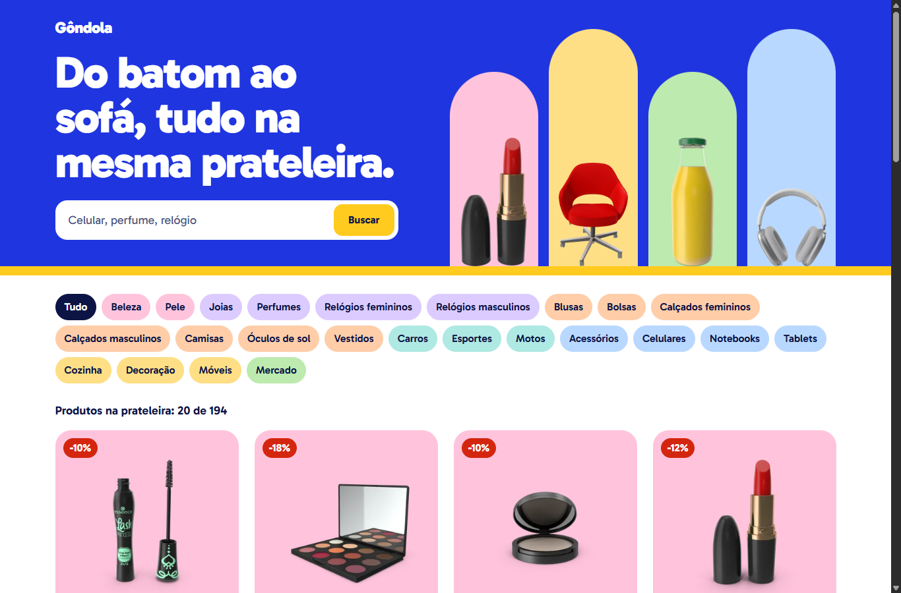

# Gôndola

Catálogo de produtos feito com HTML, CSS e JavaScript puro. Os dados vêm da API pública [DummyJSON](https://dummyjson.com/docs/products).



- **Versão:** 0.3.0 ([histórico](CHANGELOG.md))
- **Site:** https://guisantosss.github.io/ecomerce-senai/
- **Link do projeto:** https://github.com/Guisantosss/ecomerce-senai
- **Equipe:** G Santos e Amaral

## O que o site faz

- Mostra até 20 produtos em cards, com foto, preço com desconto, nota e estoque. Cada grupo de categorias tem uma cor.
- Busca por nome e por categoria, entendendo palavras comuns em português. Uma busca substitui a outra, porque a API não combina as duas.
- Abre os detalhes de um produto, consultando a API pelo código dele.
- Avisa quando não há resultado ou quando a API não responde.

## Como abrir

Acesse o [site](https://guisantosss.github.io/ecomerce-senai/) ou dê dois cliques em `index.html`. É preciso ter internet.

Para abrir em um servidor local, com Python instalado:

```
npm start
```

Depois acesse http://localhost:5500.

## Como testar

Com Node 22 ou mais novo:

```
npm test
```

Os casos e o resultado estão em [docs/teste-da-api.md](docs/teste-da-api.md).

## Arquivos

| Arquivo | Função |
|---|---|
| `index.html` | Estrutura da página |
| `css/estilo.css` | Visual dos cards e da página |
| `js/api.js` | Consultas à API e limite de 20 produtos |
| `js/app.js` | Montagem dos cards, da busca e dos detalhes |
| `js/dados.js` | Categorias, cores e palavras em português que a busca entende |
| `img/` | Fotos da vitrine e ícone |
| `tests/` | Testes da API e da busca em português |
| `docs/git-flow.md` | Como a equipe usa as branches |
| `docs/teste-da-api.md` | Teste da API |

## Como contribuir

O projeto usa git-flow. Leia [docs/git-flow.md](docs/git-flow.md) antes do primeiro commit.

## Limitações conhecidas

- Nomes e descrições dos produtos vêm em inglês. A busca entende só as palavras em português listadas em `js/dados.js`.
- Os preços estão em dólar, como a API envia.
- O projeto supõe que o preço da API é o valor antes do desconto.
